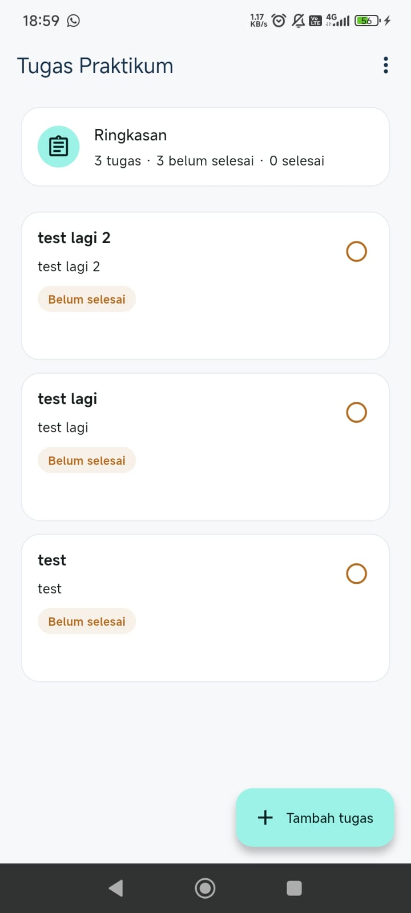
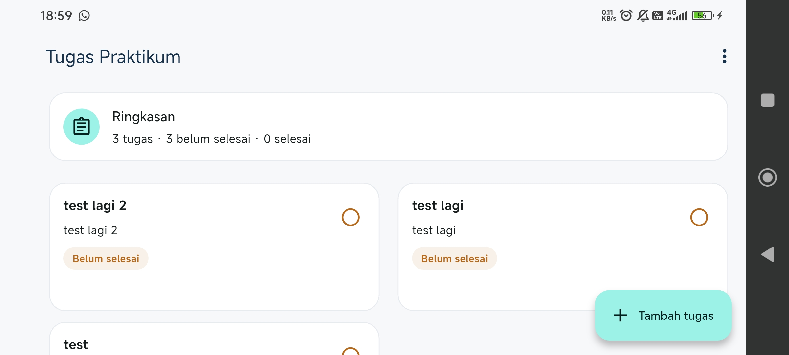

# Laporan UTS Praktikum Pemrograman Perangkat Bergerak

## 1. Identitas Mahasiswa

- **Nama**: Septian Asropik
- **NIM**: 362558302064
- **Kelas**: D4 TRPL 2A
- **Mata Kuliah**: Praktikum Pemrograman Perangkat Bergerak
- **Dosen Pengampu**: Galih Hendra Wibowo, S.Tr.Kom., M.T.

---

## 2. Jawaban Pertanyaan Teori (Soal 1 - 5)

### Soal 1: UI & Layout Responsif

**Pertanyaan**: Bagaimana strategi penerapan layout responsif pada Flutter agar aplikasi tidak mengalami _overflow_ pada layar kecil (misal: 360 px) dan mampu menyesuaikan tampilan 2 kolom pada layar tablet (≥ 700 px)?

**Jawaban**:

Penerapan layout responsif di Flutter dilakukan menggunakan `LayoutBuilder` atau `MediaQuery` untuk mendeteksi batasan lebar layar (_screen width_):

- **Layar Telepon (360 px)**: Menggunakan layout tunggal (`ListView.builder`) dengan padding/margin yang proporsional serta membungkus elemen teks dengan `Expanded` atau `Flexible` untuk mencegah _horizontal overflow_.
- **Layar Tablet (≥ 700 px)**: Menggunakan `GridView.builder` dengan `crossAxisCount: 2` (atau mengecek `constraints.maxWidth >= 700`) sehingga kartu tugas secara otomatis tersusun rapi dalam dua kolom.

---

### Soal 2: Form, Validasi, & Navigasi

**Pertanyaan**: Jelaskan mekanisme validasi input (termasuk pembersihan spasi/`trim`) serta alur pemanggilan halaman dan pengembalian data menggunakan `Navigator.push` dan `Navigator.pop`!

**Jawaban**:

- **Validasi Form**: Menggunakan `TextEditingController` dan `FormField.validator`. Fungsi `.trim()` dipanggil pada string input (`titleController.text.trim()`) untuk menghapus spasi berlebih di awal dan akhir. Jika hasil `trim()` bernilai kosong (`isEmpty`), sistem menampilkan pesan error validasi dan menolak penyimpanan data.
- **Navigasi**: Halaman form dibuka menggunakan `Navigator.push` yang mengembalikan objek `Future<Task?>`. Saat tombol **Simpan** ditekan dan validasi berhasil, `Navigator.pop(context, newTask)` dipanggil untuk mengembalikan objek `Task` baru. Jika tombol **Batal** ditekan, `Navigator.pop(context, null)` dipanggil tanpa mengubah daftar tugas.

---

### Soal 3: State Management & Interaksi Daftar

**Pertanyaan**: Jelaskan bagaimana penambahan tugas baru atau perubahan status tugas (selesai/belum) dapat langsung memperbarui tampilan kartu tugas dan ringkasan jumlah tugas secara _real-time_!

**Jawaban**:

Pembaruan tampilan secara _real-time_ memanfaatkan `StatefulWidget` dan pemanggilan `setState()`:

- Saat tugas baru ditambahkan ke `List<Task>` atau status `isCompleted` diubah (`task.isCompleted = !task.isCompleted`), perubahan dilakukan pada state lokal.
- Pemanggilan `setState()` memicu Flutter untuk merender ulang (_rebuild_) widget.
- Komponen ringkasan tugas (yang menghitung jumlah tugas selesai dan total) serta kartu tugas pada daftar otomatis diperbarui sesuai dengan data state terbaru.

---

### Soal 4: Operasi Asynchronous & State UI

**Pertanyaan**: Mengapa operasi pembacaan data dilakukan secara _asynchronous_ (`Future`/`async-await`), dan bagaimana strategi pengelolaan 4 kondisi state UI (_loading_, _empty_, _data_, dan _error_)?

**Jawaban**:

- **Operasi Asynchronous**: Pembacaan data dari penyimpanan lokal (`SharedPreferences`) memerlukan proses I/O. Menggunakan `async-await` / `Future` memastikan _UI thread_ tidak terblokir sehingga aplikasi tetap responsif dan tidak mengalami _freeze_.
- **Pengelolaan 4 State UI**:
  1. **Loading**: Menampilkan `CircularProgressIndicator()` saat data sedang dimuat.
  2. **Empty**: Jika data berhasil dimuat tetapi daftar kosong (`tasks.isEmpty`), menampilkan widget _Empty State_.
  3. **Data**: Jika data tersedia, menampilkan daftar kartu tugas beserta ringkasannya.
  4. **Error**: Jika terjadi kegagalan, menampilkan pesan error yang jelas dan menyediakan tombol **Coba Lagi** (_retry_) yang memanggil ulang fungsi pemuatan data.

---

### Soal 5: Persistensi Data Lokal & SharedPreferences

**Pertanyaan**: Jelaskan alur serialisasi data `Task` ke format JSON dan mekanisme penyimpanannya ke dalam `SharedPreferences` agar data bertahan saat aplikasi ditutup dan dibuka kembali!

**Jawaban**:

- **Serialisasi JSON**: Model `Task` dilengkapi metode `toJson()` (mengubah objek ke `Map<String, dynamic>`) dan `Task.fromJson()` (mengonversi `Map` kembali ke objek `Task`). Daftar tugas `List<Task>` di-encode menjadi string JSON menggunakan `jsonEncode()`.
- **Penyimpanan**: Menggunakan instance `SharedPreferences.getInstance()`, string JSON disimpan ke penyimpanan lokal perangkat via `prefs.setString('tasks_key', jsonString)`.
- **Pembacaan**: Saat aplikasi dibuka kembali, string JSON dibaca via `prefs.getString('tasks_key')`, didekode dengan `jsonDecode()`, lalu dipetakan (_mapping_) kembali menjadi `List<Task>` menggunakan `Task.fromJson()`.

---

## 3. Petunjuk Cara Menjalankan Aplikasi

1. **Persiapan Environtment**: Pastikan Flutter SDK telah terinstal dan emulator/perangkat fisik Android aktif.
2. **Install Dependencies**:
   ```bash
   flutter pub get
   ```
3. **Menjalankan Aplikasi**:
   ```bash
   flutter run
   ```
4. **Pemeriksaan Kode Statis**:
   ```bash
   flutter analyze
   ```
5. **Menjalankan Unit/Widget Test**:
   ```bash
   flutter test
   ```
6. **Jika ada error bisa menggunakan perintah berikut untuk mereset semua dependency**:
   ```bash
   flutter clean
   ```

---

## 4. Status Kriteria Penerimaan (_Acceptance Criteria_ A - H)

| Kriteria | Deskripsi Kriteria Penerimaan                                                                     | Status Pengerjaan | Catatan                                                                                                                             |
| :------: | :------------------------------------------------------------------------------------------------ | :---------------: | :---------------------------------------------------------------------------------------------------------------------------------- |
|  **A**   | Telepon (360 px): Tidak ada _overflow_ horizontal & kontrol terbaca.                              |    [x] Selesai    | Layout menggunakan `ListView.builder` dan `Expanded`/`Flexible`. Telah diuji pada layar 360 px tanpa terjadi horizontal overflow.   |
|  **B**   | Tablet (≥ 700 px): Kartu tersusun 2 kolom dan tetap terbaca.                                      |    [x] Selesai    | Menggunakan `LayoutBuilder` / `GridView.builder` dengan `crossAxisCount: 2` pada lebar ≥ 700 px, kartu tersusun rapi dalam 2 kolom. |
|  **C**   | Form Validasi: Judul/Mata kuliah kosong/spasi ditolak dengan pesan validasi.                      |    [x] Selesai    | Fungsi `.trim()` diterapkan pada input Judul & Mata Kuliah; input kosong/hanya spasi berhasil ditolak dengan pesan error.           |
|  **D**   | Navigasi: Detail menerima `Task`; Simpan kembalikan data; Batal tidak ubah data.                  |    [x] Selesai    | Navigasi `Navigator.push` dan `pop(context, newTask)` berjalan baik; tombol Batal mengembalikan `null` tanpa mengubah state.        |
|  **E**   | State: Penambahan & perubahan status langsung perbarui daftar dan ringkasan.                      |    [x] Selesai    | Pemanggilan `setState()` memperbarui daftar tugas dan komponen ringkasan (_counter_) secara _real-time_ saat data berubah.          |
|  **F**   | Async & State UI: State _loading_, _empty_, _data_, & _error_ tampil; tombol Coba Lagi berfungsi. |    [x] Selesai    | Berhasil mengelola 4 state UI (`isLoading`, `isEmpty`, `isError`, dan `hasData`). Tombol _Coba Lagi_ berfungsi memuat ulang data.   |
|  **G**   | Persistensi: Data dan status tetap bertahan setelah aplikasi ditutup & dibuka kembali.            |    [x] Selesai    | Menggunakan `SharedPreferences` dan `jsonEncode`/`jsonDecode`; data tugas dan status `isCompleted` tersimpan secara permanen.       |
|  **H**   | Verifikasi: Aplikasi berjalan lancar, hasil `flutter analyze` & langkah uji dicatat.              |    [x] Selesai    | Pengujian manual dan pemeriksaan statis `flutter analyze` berjalan lancar tanpa menemukan kesalahan (_no issues found_).            |

---

## 5. Ringkasan Alur Kode Utama

> **Alur Pengisian Form hingga Persistensi Data**:
>
> 1. Pengguna menekan tombol Tambah Tugas di `TaskListScreen` -> memicu `Navigator.push` ke `TaskFormScreen`.
> 2. Di `TaskFormScreen`, pengguna mengisi Judul & Mata Kuliah. Saat tombol **Simpan** ditekan, input di-`trim()`. Jika valid, objek `Task` baru dibuat dan dikembalikan via `Navigator.pop(context, newTask)`.
> 3. `TaskListScreen` menerima `newTask`, memasukkannya ke dalam `List<Task>`, dan memanggil `TaskStorage.saveTasks(tasks)`.
> 4. `TaskStorage` mengubah `List<Task>` menjadi string JSON via `jsonEncode` dan menguncinya di `SharedPreferences`.
> 5. `setState()` dipanggil di `TaskListScreen` untuk memperbarui tampilan daftar dan ringkasan secara instan.

---

## 6. Catatan Error Tersisa / Belum Selesai

> **Status**: Semua fitur dan kriteria penerimaan (A - H) telah diselesaikan dengan baik. Tidak ada bug atau error yang tersisa, aplikasi berjalan dengan lancar saat dilakukan pengujian manual maupun pemeriksaan statis.

---

## 7. Bukti Keluaran `flutter analyze`

```text
flutter analyze
Analyzing starter-uts...
No issues found! (ran in 3.4s)
```

## 8. Bukti Tampilan Aplikasi (Screenshot)

Berikut adalah bukti tangkapan layar aplikasi yang dijalankan pada mode tampilan HP dan Tablet:

### Tampilan Telepon (360 px)


_Keterangan: Tampilan list card tugas secara vertikal (1 kolom) pada layar telepon tanpa terjadi overflow._

### Tampilan Tablet (≥ 700 px)


_Keterangan: Tampilan card tugas tersusun dalam 2 kolom secara responsif pada layar tablet._
